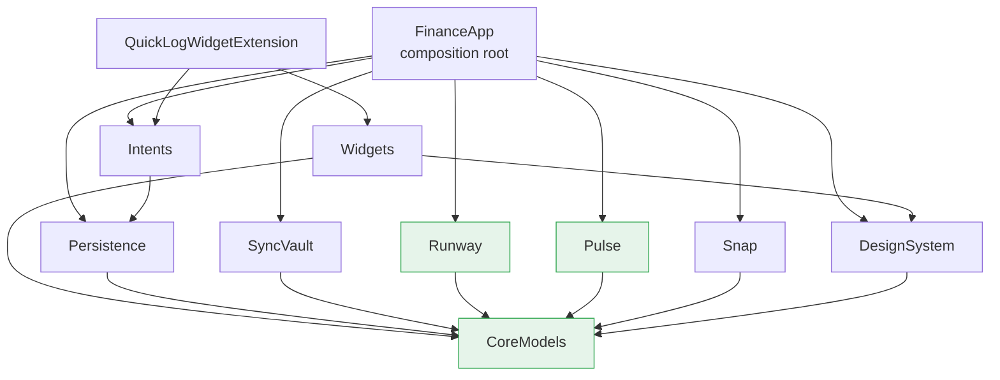
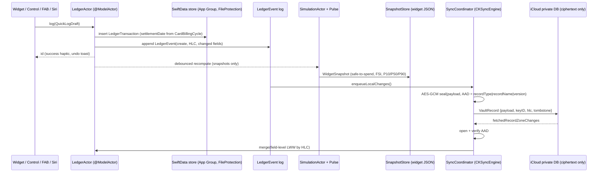
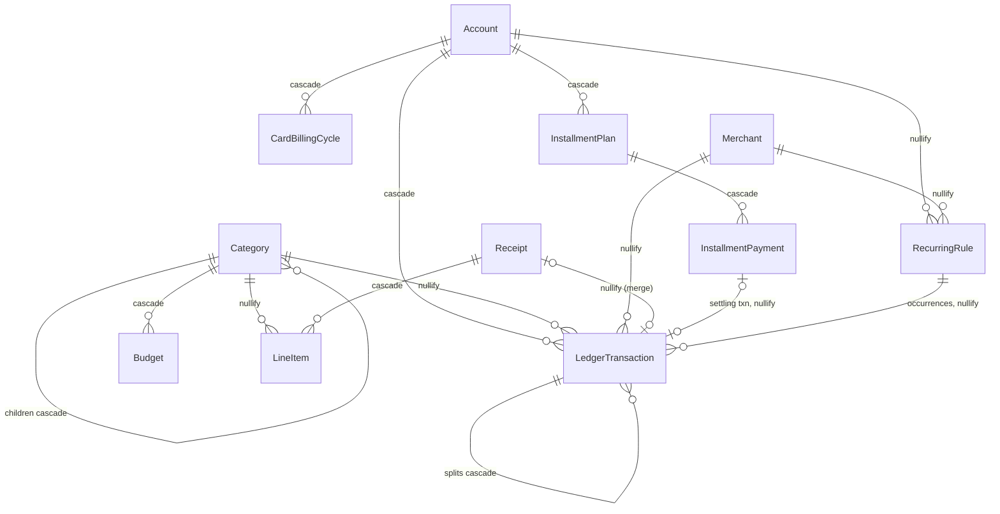

# Finance App: Architecture (Project Structure & Data Model)

This document follows `finance-app-blueprint.md` (Phase 3b). It covers the **module layout, data model, sync/encryption mapping, and testing strategy**. Feature UI comes in later deliverables.

**Status labels used below:**
✅ = verified on Linux with Swift 6.2: compiled and unit-tested.
🟡 = syntax-checked with `swiftc -parse` only. These need Apple SDKs, so they still have to be built in Xcode on a Mac.

---

## 1. Repository layout

```
finance-app/
├── project.yml                  # XcodeGen spec → FinanceApp.xcodeproj (generated, not committed)
├── ARCHITECTURE.md
├── App/
│   ├── FinanceApp/              # @main app = composition root (AppContainer), tabs, AppShortcuts
│   ├── QuickLogWidgetExtension/ # @main WidgetBundle (thin: views live in Widgets package)
│   └── ShareExtension/          # Snap share-sheet ingestion (Phase 4 placeholder)
└── Packages/                    # one local SPM package per module, each with Tests/
    ├── CoreModels/    ✅ Money, CurrencyCode, enums, HLC, card settlement, installments, snapshots
    ├── Persistence/   🟡 SwiftData SchemaV1 @Models, MigrationPlan, ModelContainerFactory, LedgerActor
    ├── SyncVault/     🟡 CryptoKit envelope + key hierarchy, CKRecord mapper, CKSyncEngine coordinator
    ├── Runway/        ✅ Monte Carlo cash-flow simulator (seeded), SimulationActor
    ├── Pulse/         ✅ Financial Stress Index calculator
    ├── Snap/          ✅ heuristic parser + matcher (Linux-tested); 🟡 FoundationModels extractor
    ├── DesignSystem/  🟡 tokens, color assets, MoneyText, Liquid Glass QuickAddButton
    ├── Widgets/       🟡 App-Group snapshot store, SafeToSpend widget
    └── Intents/       🟡 LogExpenseIntent (openAppWhenRun = false)
```

Why use local SPM packages instead of Xcode framework targets?
- Each package has its own boundary that the compiler enforces.
- Packages build in parallel and can be tested on their own.
- The pure-domain packages run `swift test` on Linux CI without a simulator.
- Merge conflicts in the `.pbxproj` disappear, because XcodeGen generates the project.

## 2. Module boundaries & dependency graph



Rules:
| Module | Allowed imports | Must not |
|---|---|---|
| CoreModels | Foundation | Use SwiftUI, SwiftData, CloudKit, or any `@Model` |
| Runway, Pulse | CoreModels | Do persistence or networking. Inputs and outputs are value types |
| Snap | CoreModels, Vision, FoundationModels (`#if canImport`) | Write to the store. It returns `ReceiptDraft`, and the App saves it |
| Persistence | CoreModels, SwiftData | Let a `@Model` escape its actor. Features receive `Sendable` snapshots |
| SyncVault | CoreModels, CryptoKit, CloudKit | Import Persistence. It talks to the local store through the `SyncLocalStore` protocol, which keeps it zero-knowledge-testable with fakes |
| DesignSystem | CoreModels, SwiftUI | Contain business logic |
| Widgets / Intents | Read the snapshot or write through `LedgerActor` | Load the full ledger (this keeps the quick-log path cold-start cheap) |

Only `App/` knows about concrete types. `AppContainer` wires up `LedgerActor`, `SimulationActor`, `StressIndexCalculator`, and later the `SyncCoordinator`.

## 3. Data flow



- **Reads.** SwiftUI uses `@Query` for lists, which runs on the main-actor context. Analytics go through `LedgerRepository` async methods that return snapshots.
- **Writes.** Every write goes through `LedgerActor`. Each mutation and its `LedgerEvent` are saved together, so they're atomic.
- **Quick-log while locked.** The store uses `NSFileProtectionComplete`, so extensions can't open it while the device is locked. Lock Screen logging should go to a small append-only `QuickLogOutbox` file (`CompleteUntilFirstUserAuthentication`) that the app drains when it next unlocks. *This isn't written yet. It's the next Persistence task.*

## 4. Data model (SchemaV1)



### 4.1 Money & currency
- **Storage.** Money is stored as an `Int64` of minor units (agorot or cents) plus a `currencyCode` String (ISO 4217). It's never stored as `Double` or `Decimal`. Storing `Decimal` in SwiftData has had sorting and predicate problems, and integer sums are exact and fast.
- **Domain.** The domain type is `Money { amount: Decimal, currency: CurrencyCode }`.
  - `minorUnits` uses banker's rounding at the currency's ISO exponent: JPY = 0, ILS = 2, KWD = 3.
  - Adding two amounts in different currencies **throws**. It doesn't silently convert.
  - `allocate(into:)` splits an amount exactly. Any leftover agorot go on the first payment, which is what the installment schedule uses.
- **Foreign purchases.** These keep `originalAmountMinor`, `originalCurrencyCode`, and the exact `fxRate` (stored as a decimal string) next to the amount in the account's currency.
- **Sign convention.** Negative is an outflow. `kind` (expense, income, transfer, adjustment) is stored separately, because refunds and transfers need both.
- **Default currency.** `CurrencyCode.default = .ils`. Onboarding overrides it from `Locale`.

### 4.2 Israel-specific modelling
- **CardBillingCycle.** Stores `chargeDay`, `statementCloseDay`, and `effectiveFrom` for each card account. Because it's versioned by `effectiveFrom`, changing the charge day doesn't rewrite history.
  - `LedgerActor.log` sets `settlementDate` from it.
  - Runway uses `cashFlowDate = settlementDate ?? date`, so "spent today" and "cash leaves on the 10th" are kept apart.
- **Installments (tashlumim).** Modelled as `InstallmentPlan` (kind `tashlumim`, `credit`, or `deferred`, plus an optional APR string) with N `InstallmentPayment` rows.
  - The original purchase links to the plan as `originatingTransaction`. Budgets count it once, at purchase.
  - The payments carry the cash flow, so Runway counts each payment on its due date.
  - A card charge that later posts links to its payment through `settlingTransaction`.

### 4.3 Sync-readiness fields (on every model)
- `id: UUID` with `@Attribute(.unique)`. This is allowed because SwiftData's automatic CloudKit mirroring is **off**.
- `updatedHLC: String`, the hybrid logical clock value. It sorts correctly as a plain string.
- `isTombstoned: Bool`. User deletes are *soft*. SwiftData delete rules only apply to hard purges, such as retention cleanup or "Erase all data". The rules are:
  - **cascade** for owned children: splits, line items, payments, billing cycles, budgets.
  - **nullify** for references, so a transaction survives when its category or merchant is deleted.
- `LedgerEvent` is the append-only log. It stores entity type and id, the operation, the HLC, the JSON of changed fields, and the sync state. It drives sync, undo, and the guarantee that data can't silently vanish.

### 4.4 Indexes (`#Index`, iOS 18+)
| Model | Indexes | Serves |
|---|---|---|
| LedgerTransaction | `date`, `settlementDate`, `(isTombstoned, date)`, `(kindRaw, date)`, `externalID`, `needsReview` | Ledger list, Runway, category-month aggregates, import dedup, review inbox |
| Account | `isArchived`, `kindRaw` | Account picker |
| Category | `(kindRaw, sortOrder)` | Chip carousel |
| Merchant | `normalizedKey` (also unique) | Snap and import matching |
| Receipt | `(statusRaw, capturedAt)`, `purchaseDate` | Snap inbox, merging receipts into transactions |
| RecurringRule | `(isActive, nextDueDate)` | Runway's scheduled flows |
| InstallmentPlan / Payment | `(isCompleted, firstChargeDate)`, `dueDate`, `(isSettled, dueDate)` | Runway, commitment load |
| LedgerEvent | `(syncStateRaw, hlc)`, `entityID`, `hlc` | Sync outbox, history |
| Budget / CardBillingCycle | `startDate` / `effectiveFrom` | Period lookup |

### 4.5 Migrations
- **Model versions.** `SchemaV1: VersionedSchema` nests all the models. The rest of the app uses only the top-level `typealias`es (`Account = SchemaV1.Account`, and so on).
- **Making a schema change.**
  1. Copy SchemaV1 to SchemaV2 and change the copy.
  2. Point the typealiases at V2.
  3. Add a stage to `LedgerMigrationPlan`: `.lightweight` for additive changes or renames (`@Attribute(originalName:)`), and `.custom` for reshaping data.
- **Sync payloads** have their own `payloadVersion`. An older device ignores fields it doesn't recognise, which means schema changes must be **additive-only** once sync is live.

## 5. Vault: encryption & CloudKit record mapping

**Key hierarchy**
```
24-word recovery phrase ─HKDF-SHA256(info "finance.vault.kek.v1")→ KEK
KEK ─AES-KeyWrap→ wrapped DEK  → iCloud Keychain (kSecAttrSynchronizable)
DEK (AES-256) ─AES-GCM→ every record payload
Secure Enclave P-256 → wraps the *local* DEK cache only (non-syncable)
```

**CKRecord layout.** There is a single opaque record type, `VaultRecord`, in the custom zone `LedgerZone` of the private database.
| Field | Contents | Protection |
|---|---|---|
| recordName | `"<EntityType>.<UUID>"` | plaintext (CloudKit requires it). *Option: HMAC the name so even the entity type is hidden* |
| payload | AES-GCM combined (nonce, ciphertext, tag) of the entity JSON | **client-side, zero-knowledge** |
| keyID | Which DEK sealed it (for rotation) | CloudKit `encryptedValues` |
| payloadVersion | Version of the payload schema | `encryptedValues` |
| hlc | HLC string for last-writer-wins | `encryptedValues` |
| tombstone | 0 or 1 | plaintext (contains no financial information) |

- **AAD.** The authenticated data is `recordType|recordName|v<payloadVersion>`. A server, or Apple, can't swap a payload from one record into another without decryption failing. The test `aadPreventsRecordSwap` covers this.
- **Conflicts.** Merges are field-level last-writer-wins by HLC (`HybridLogicalClock.receive` on every inbound record). Deletes are tombstones, and splits are events. A `serverRecordChanged` error triggers a merge followed by a re-enqueue (marked TODO in `SyncCoordinator`).
- **Mirroring is off.** SwiftData's built-in CloudKit mirroring is disabled (`cloudKitDatabase: .none`), because it would upload plaintext.

## 6. Testing strategy

| Layer | Tooling | Status in this deliverable |
|---|---|---|
| CoreModels | Swift Testing, parameterized | ✅ 11 tests pass on Linux: money exactness, splits that always sum, negative amounts, JPY, card settlement across year-end, the tashlumim schedule, HLC monotonicity and merge |
| Runway | Swift Testing with seeded `SplitMix64` | ✅ 2 tests: runs are deterministic, P10 ≤ P90, and risk is detected when the card bill lands before salary |
| Pulse | Swift Testing | ✅ 3 tests: calm and stressed extremes, weights sum to 1 |
| Snap (heuristic) | Swift Testing | ✅ 2 tests: Hebrew total and installment parsing, matcher tolerance |
| Persistence | In-memory `ModelContainer` | 🟡 Written (quick-log round trip, invariant that splits sum, installment sum). They need macOS or iOS to run |
| SyncVault | CryptoKit round-trip, AAD tamper, key wrap | 🟡 Written. Next: two fake `SyncLocalStore` instances plus a fake CKSyncEngine transport for chaos tests (offline edits, conflicting splits, key rotation) |
| Performance | Week-1 spike: seed 100k transactions, measure `monthlySpendByCategory` with XCTest `measure` | Budget: under 50 ms, or move the analytics read model to Core Data or GRDB |
| UI | Snapshot tests across Dynamic Type, RTL, dark mode, Reduce Transparency, and both ends of the Glass slider; XCUITest for quick-log; AppIntentsTesting | Later deliverable |

**CI suggestion.**
- A Linux job runs `swift test` in CoreModels, Runway, Pulse, and Snap. It's fast and cheap.
- A macOS job runs `xcodebuild test` on the generated scheme, which includes every package's tests.

## 7. Known gaps / next steps
1. Write the `QuickLogOutbox` for logging while the device is locked, and have the app reconcile it on launch.
2. Write the `SyncLocalStore` adapter over `LedgerActor`, which turns `LedgerEvent` rows into the outbox and merges inbound changes into models.
3. Store a stable per-install device ID in the Keychain. `LedgerActor` currently uses a random ID for each process launch.
4. Write the keychain and recovery-phrase services (BIP-39 word list, `kSecAttrSynchronizable`, Secure Enclave wrapping).
5. Seed system categories, including Israeli defaults: arnona, va'ad bayit, gan, and so on.
6. Run the 100k-transaction benchmark in week 1.
